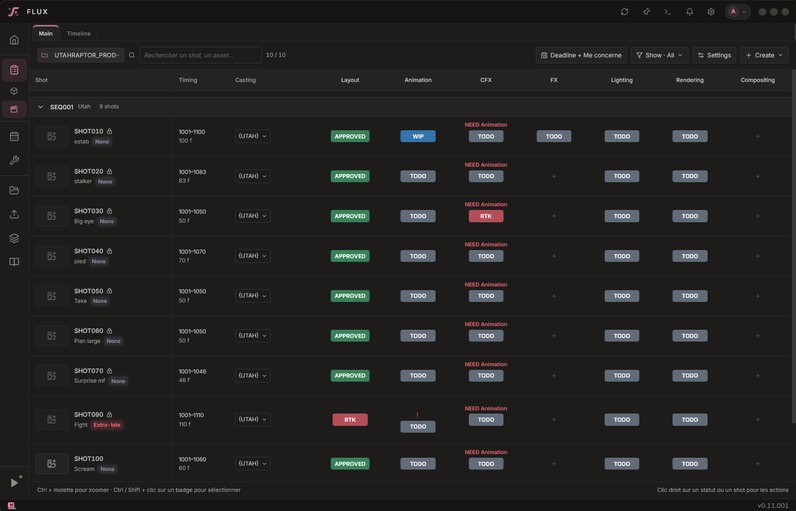
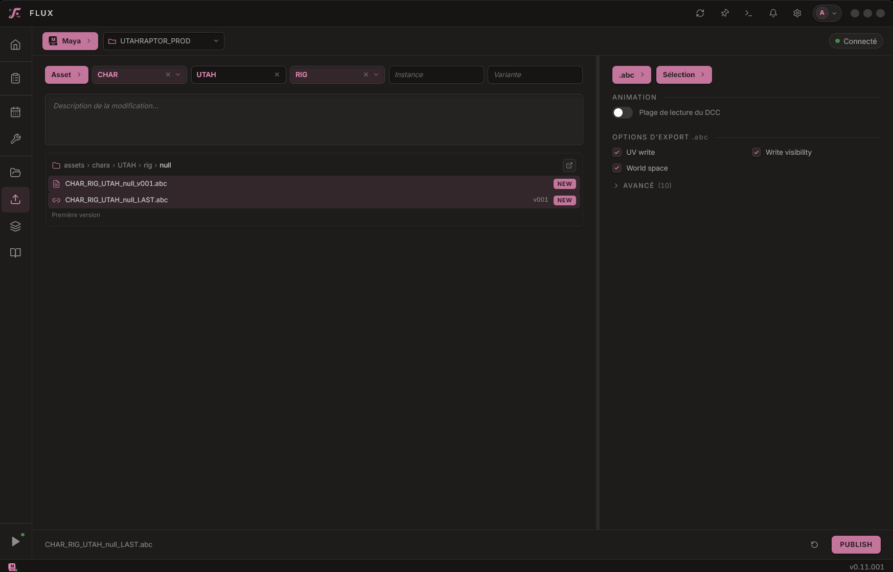
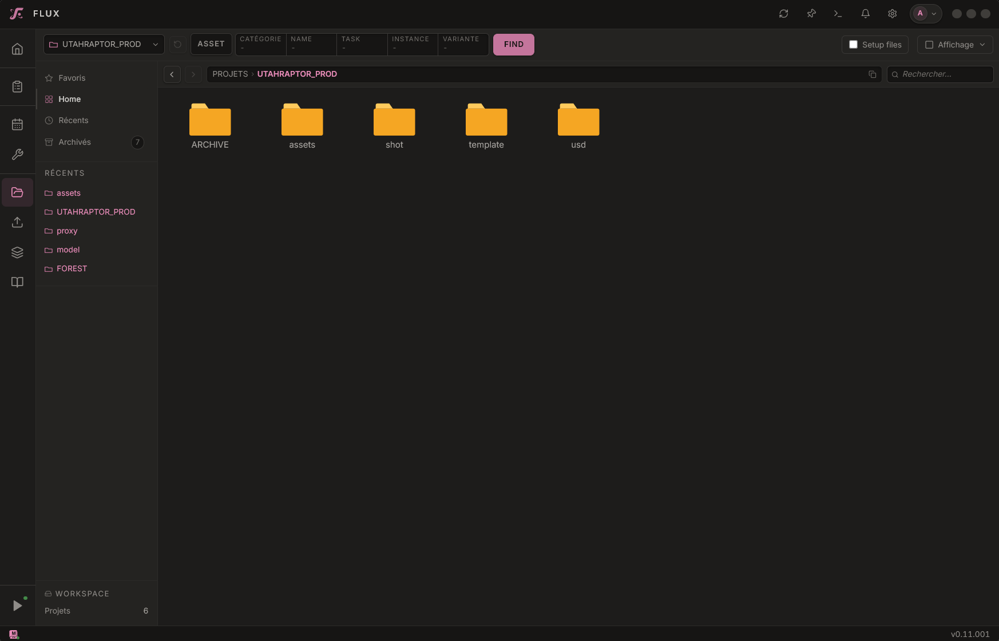
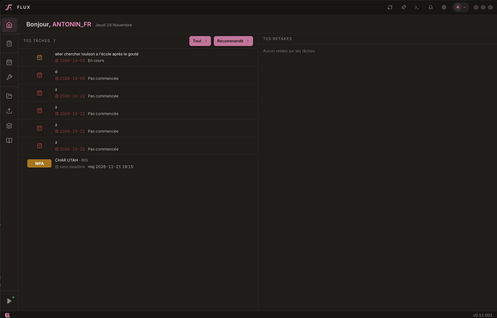
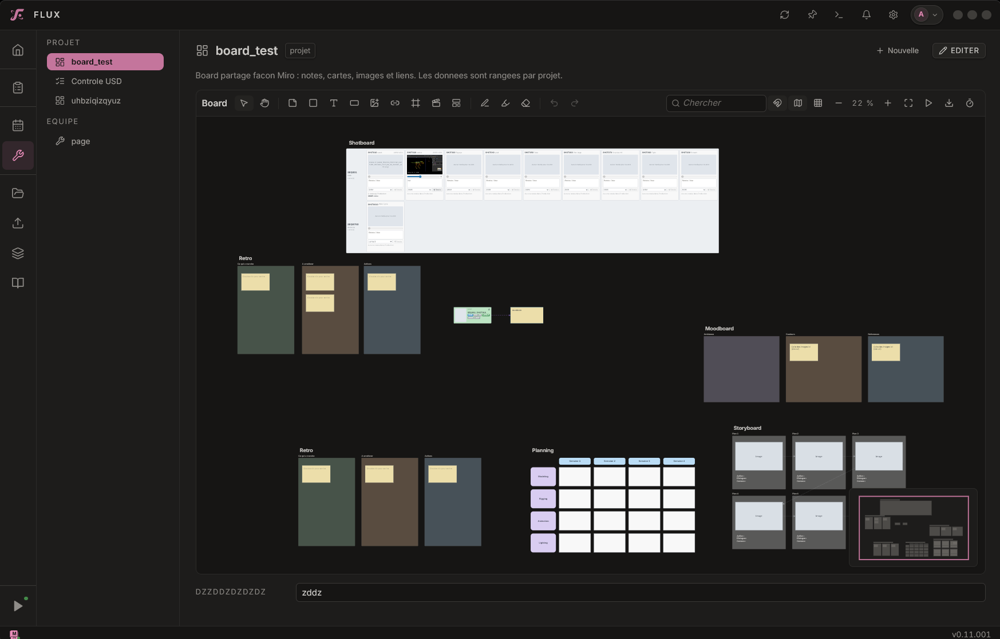
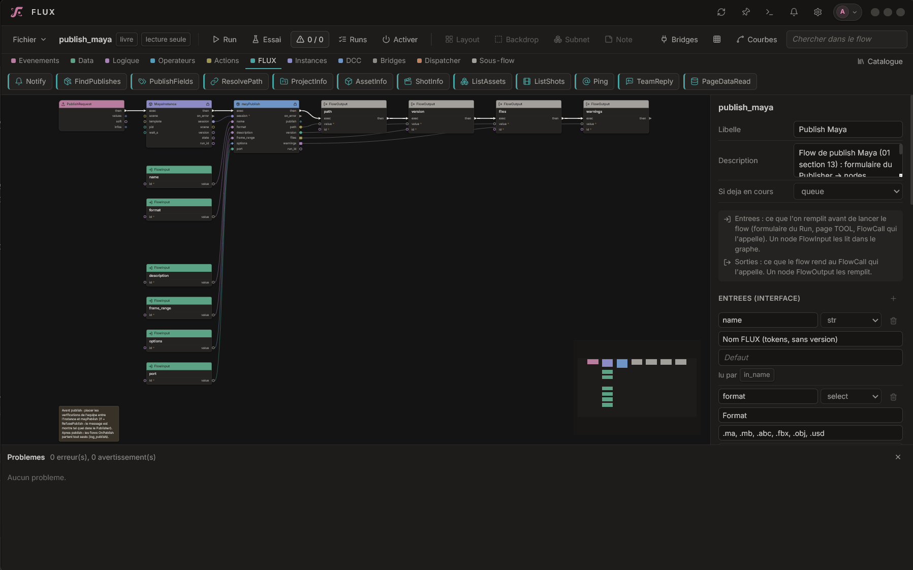

<p align="center">
  
</p>

<h1 align="center">FLUX</h1>

<p align="center">
  A desktop pipeline for 3D animation and VFX teams: folders, versions, publishes, USD and tracking in one app.
</p>

<p align="center">
  <a href="LICENSE"></a>
  
  
</p>

---

FLUX is built by students. One of its goals is to run in production at ESMA. It is local-first: a project lives in a
plain folder (local disk, OneDrive or a file server), FLUX keeps it organised, and no step of the pipeline consumes a
DCC license.

<p align="center">
  
</p>

<table>
  <tr>
    <td></td>
    <td></td>
  </tr>
  <tr>
    <td align="center"><sub>Publish from your DCC: <code>vNNN</code> + <code>LAST</code>, named for you</sub></td>
    <td align="center"><sub>Project browser with token search</sub></td>
  </tr>
  <tr>
    <td></td>
    <td></td>
  </tr>
  <tr>
    <td align="center"><sub>Home: your tasks and retakes</sub></td>
    <td align="center"><sub>Shared team board per project</sub></td>
  </tr>
  <tr>
    <td colspan="2"></td>
  </tr>
  <tr>
    <td colspan="2" align="center"><sub>Flows: automate pipeline tasks with nodes</sub></td>
  </tr>
</table>

## What FLUX does

* **Project tree from naming rules.** Define your tokens once, FLUX creates and names every asset, shot and task folder.
* **Safe, versioned publishes.** Every publish is an immutable `vNNN` folder plus a `LAST` pointer. Nothing is overwritten.
* **One-click import into your software.** Load the right version of an asset in Maya, Houdini and the other DCCs.
* **USD assembly.** Assets, sets and shots are assembled as USD layers automatically after each publish.
* **Production tracking.** Tasks, statuses, reviews, team activity, chat and calendar in the same app.
* **Render farm submission** and **Flows**, a node editor to automate pipeline tasks without writing code.

### Supported software

| Status | Software |
|---|---|
| Validated in production use | Maya, Houdini, ZBrush |
| Bridges (working, less tested) | Nuke, Substance 3D Painter / Designer, Mari, Marvelous Designer, Photoshop |

## Install

**Windows 10 / 11 only** for now.

### Installer

Download `FLUX-Setup-<version>.exe` from the Releases page of this repository and run it. It installs for the current
user, no admin rights needed. To update a whole team, drop the new installer in the `FLUX_UPDATE/` folder of the shared
workspace: FLUX offers the update on start.

### From source

Requirements: [Node.js](https://nodejs.org/) (with npm) and Python 3.13.

```bash
pip install -r backend/requirements.txt
npm install
npm run dev
```

On Windows you can also double-click `INSTALL_DEV.bat` once, then `FLUX_DEV.bat` to start.
Electron opens the app and starts the Python backend for you.

## First steps

1. **Pick a workspace folder and your user name.** On first launch FLUX asks for the root folder of your team (local,
   OneDrive or a studio server). Projects, per-user settings and team config all go inside it.
2. **Create a project.** Choose a name and a naming template. FLUX builds the folder tree.
3. **Add assets and shots**, then open a task in your DCC from FLUX.
4. **Publish** from inside the DCC. The new version shows up in FLUX, ready to be imported by the rest of the team.

The full user manual (in French) is built into the app: **Settings > Doc**.

## Documentation

| I want to | Read |
|---|---|
| Use FLUX as an artist | The manual in the app (Settings > Doc), source `backend/resources/manual/FLUX_Manuel.html` |
| Automate with Flows | [docs/user/flows/](docs/user/flows/) (French) |
| Understand the architecture | [docs/architecture/](docs/architecture/) and the decision records in [docs/decisions/](docs/decisions/) |
| Build or package FLUX | [docs/development/BUILD.md](docs/development/BUILD.md), [docs/development/STRUCTURE.md](docs/development/STRUCTURE.md) |
| Find anything else | [docs/README.md](docs/README.md) |

### Architecture at a glance

```
app/electron (Electron main)  --spawn-->  backend/main.py   FastAPI on 127.0.0.1 (per-launch token)
app/src      (React + TS)     --HTTP-->   backend/routers  ->  features/*          domain logic
                                                           ->  flux_actions        YAML action engine (publish)
                                                           ->  flux_flows          Flows engine
                                                           ->  dcc/<software>      backend clients + in-DCC plugins
Metadata: JSON (default) or SQLite        File bytes: filesystem only, never through the API
```

## Contributing

Bug reports, ideas and pull requests are welcome. Start with [CONTRIBUTING.md](CONTRIBUTING.md).
Please read the [Code of Conduct](CODE_OF_CONDUCT.md), and report security issues privately as described in
[SECURITY.md](SECURITY.md).

## License

FLUX is licensed under the [Mozilla Public License 2.0](LICENSE). In short: you can use FLUX freely, including inside a
studio, and modify it. If you distribute FLUX or a modified version, the FLUX files you ship (and your changes to them)
must stay open under the MPL-2.0. Your own separate code can keep its own license.
Third-party components keep their own licenses, see [NOTICE](NOTICE).
